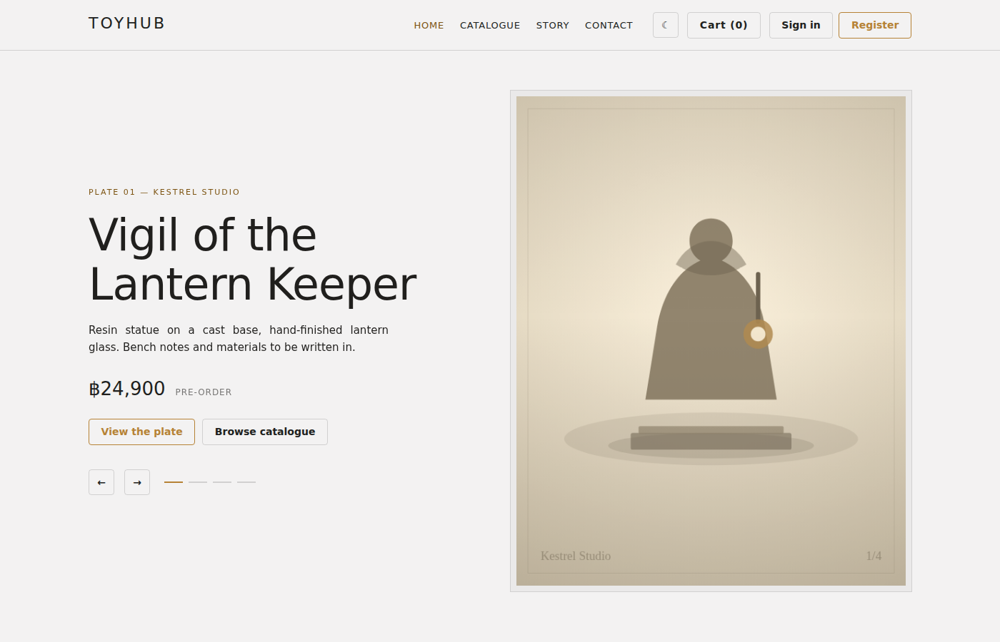
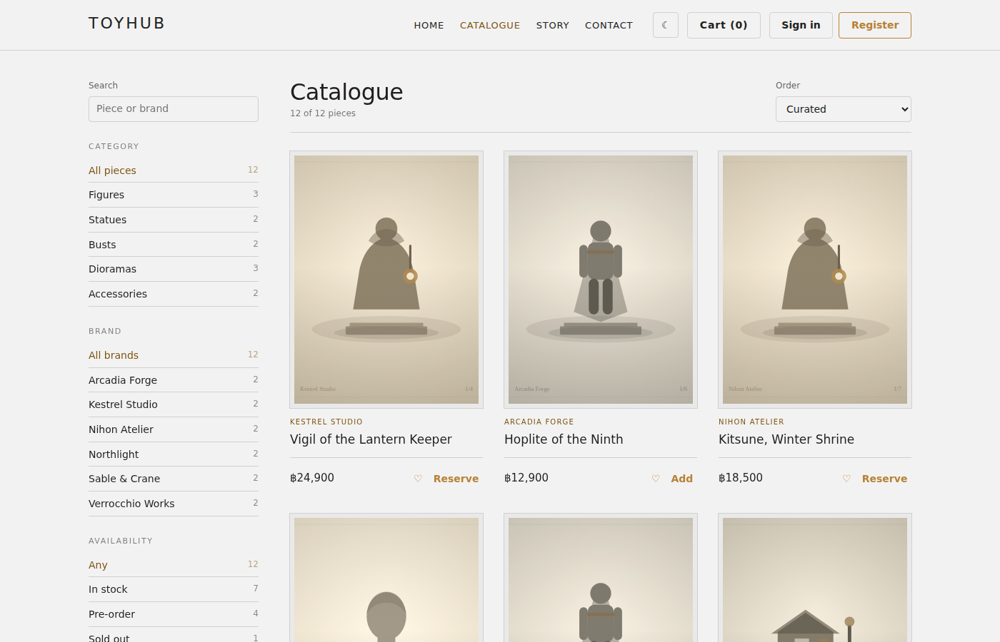
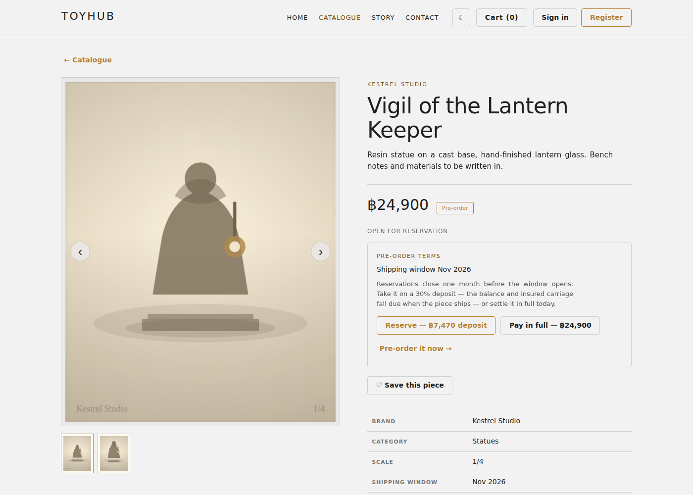
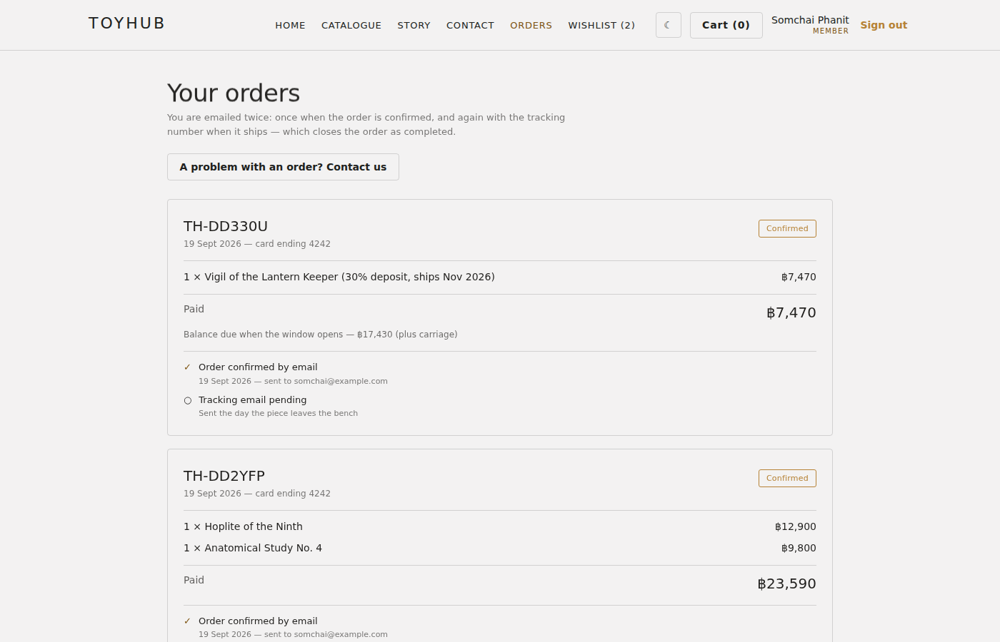
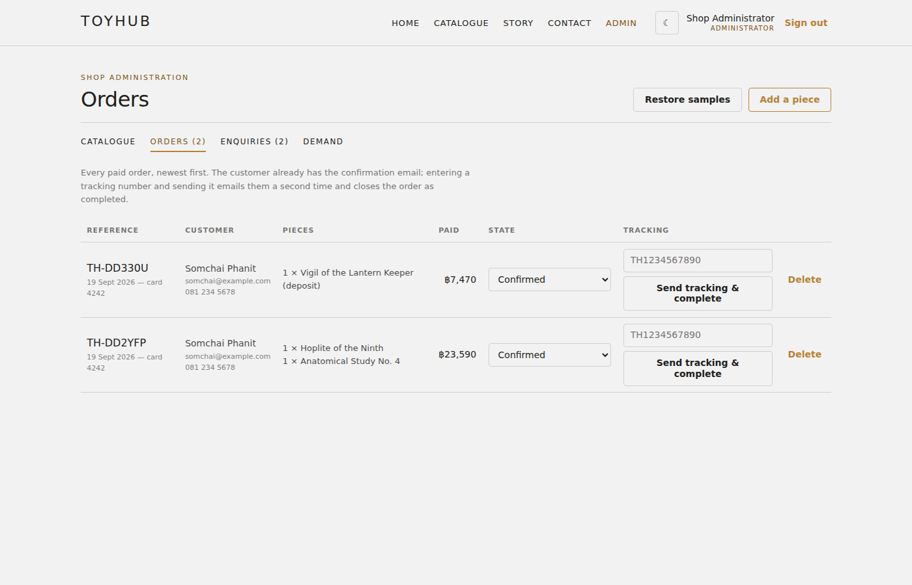

# ToyHub

A storefront for collectible figures — browse a catalogue, reserve a pre-order on a
deposit, pay by card, and track the order through to delivery. Behind it sits a shop
administration area for the catalogue, the order desk and the customer inbox.

[](https://github.com/PhiraponIntasit/toyhub-app1/actions/workflows/ci.yml)

**Live demo — <https://toyhub-app1.vercel.app>**

| Role | Email | Password |
| --- | --- | --- |
| Customer | `somchai@example.com` | `demo1234` |
| Shop administrator | available on request | — |

The administrator side of the demo is held back so that the catalogue survives — the
order desk is the last screenshot below, and all of it is in
[`public/js/views/admin.js`](toyhub/public/js/views/admin.js). Run it locally and the
seed creates `admin@toyhub.co` / `admin1234`.

Payments run in Stripe **test mode**: pay with card `4242 4242 4242 4242`, any future
expiry, any CVC. No real money moves.

---



| | |
| --- | --- |
|  |  |
|  |  |

## What it does

**For a customer** — filter the catalogue by category, availability and price; save
pieces to a wishlist; add to a cart or buy a single piece outright. A pre-order can be
taken on a 30% deposit with the balance due when it ships, or settled in full. Card
details are collected by Stripe Elements and never reach this server. When a reserved
piece arrives the customer is emailed what is left to pay and settles it from the same
orders page. Past orders, their state and the emails sent about them are all on one page.

**For the shop** — add, edit and delete pieces, choose the four that lead the homepage,
and watch stock fall automatically as orders come in. The order desk moves an order
through its states, asks for an outstanding balance and sends a tracking number. The
inbox holds customer enquiries, and
a demand tab counts how many people have saved each piece — including ones that are
sold out.

## How it is built

Node.js + Express + PostgreSQL on the server. The frontend is plain HTML, CSS and
JavaScript — native ES modules, **no framework and no build step**. The browser loads
the same files that are in the repository.

Decisions worth explaining:

**Prices and stock are always recomputed from the database.** The browser sends only
which piece and how many; every amount charged is derived server-side in
[`resolveLines`](toyhub/server/lib/orders.js). A tampered cart cannot change a price.

**An order is written in one transaction.** The order row, its lines and the stock they
consume commit together or not at all, and stock is decremented in SQL
(`stock - $1`) rather than from a value read earlier, so two checkouts racing cannot
overwrite each other's figure.

**Carriage is billed on the box, and not until the box exists.** A parcel is charged on
whichever is greater, its actual weight or its volumetric weight
(`L × W × H ÷ 5000`), so a light but bulky figure pays for the space it takes
([`shipping.js`](toyhub/server/lib/shipping.js)). A deposit on a piece a year out is
therefore not charged carriage at all: the figure is worked out when the piece lands
and the shop asks for the balance, then frozen on the order so what the customer was
shown is what they pay. Nothing ships while any of it is outstanding.

**No `innerHTML` anywhere.** The DOM is built through a small
[`h()` helper](toyhub/public/js/dom.js) that only ever sets text nodes and attributes,
so a product name or a customer message cannot inject markup. Every SQL statement is
parameterised.

**Sessions live in Postgres,** not in memory — passwords are bcrypt-hashed, the cookie
is `httpOnly` and `secure` in production, and the app is stateless enough to run on
serverless functions.

**Rendering is a full redraw, deliberately.** State changes rebuild the tree rather than
diffing it, which keeps the code small; typing is exempt from it, since a redraw per
keystroke both flickers and destroys what is being typed.

```
toyhub/
  server/
    app.js            express wiring (exported — index.js listens, api/ serves)
    db.js             pg Pool, TLS and pool size by environment
    migrations/       SQL schema
    routes/           auth, products, wishlist, messages, orders/checkout
    lib/              pricing helpers, order reading/writing, mailer, stripe
  public/             served as-is
    js/views/         one module per screen
    images/plates/    catalogue artwork
  test/               node:test suites
  api/index.js        Vercel entry point
```

## Running it locally

Needs Node 20+ and PostgreSQL.

```bash
cd toyhub
npm install
cp .env.example .env     # set DATABASE_URL and SESSION_SECRET
npm run migrate
npm run seed
npm start                # http://localhost:3000
```

Stripe keys are optional. Without them the app runs in full and checkout shows a
"payment gateway not configured" notice instead of failing; with the free test keys
from <https://dashboard.stripe.com/test/apikeys> checkout completes end to end.

## Tests

```bash
createdb toyhub_test
TEST_DATABASE_URL=postgres://…/toyhub_test npm test
```

38 tests over pricing and carriage arithmetic, authentication and permissions, the
order write path and the pre-order balance — including that a failed write rolls back
without consuming stock, that nothing ships while money is outstanding, and that
loading orders costs three queries no matter how many there are. The suite refuses to
run unless `TEST_DATABASE_URL` is set, because it truncates every table. CI runs it on
every push against a PostgreSQL service container.

## Deploying to Vercel + Supabase

Step by step in [`toyhub/DEPLOY.md`](toyhub/DEPLOY.md). In short: create the schema on
a Supabase database from your own machine, import the repository on Vercel with
**Root Directory** set to `toyhub`, and give it `DATABASE_URL` (the pooler string on
port 6543), `SESSION_SECRET` and the two `STRIPE_*` keys. `vercel.json` sends `/api/*`
to the Express app and serves `public/` as static files; `/api/health` reports whether
the database is reachable.

## Known limitations

Deliberate, given this is a portfolio build rather than a live shop:

- **Email is mocked.** Confirmation and tracking messages are written to the
  `email_log` table and the console instead of being sent, so the timeline in the app is
  backed by real records. [`lib/mailer.js`](toyhub/server/lib/mailer.js) is the single
  function to replace with a provider.
- **No Stripe webhook.** The order is written when the browser reports a successful
  payment. Taking real money would mean moving that to a `payment_intent.succeeded`
  webhook, so a closed tab cannot lose an order.
- **No rate limiting or security headers.** The administrator password above is the
  seed default, published here on purpose so the demo can be looked around; a
  deployment sets `ADMIN_EMAIL` and `ADMIN_PASSWORD` instead. Fine for a demo, none of
  it fine for a real shop.

The design came from a prototype built in Claude Design; the original brief and
conversation are in [`project/`](project/) and [`chats/`](chats/).
